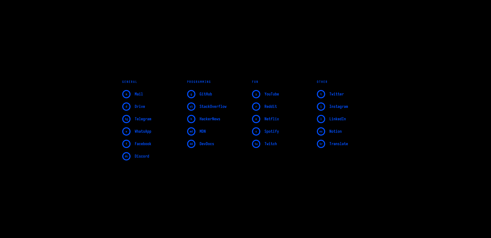
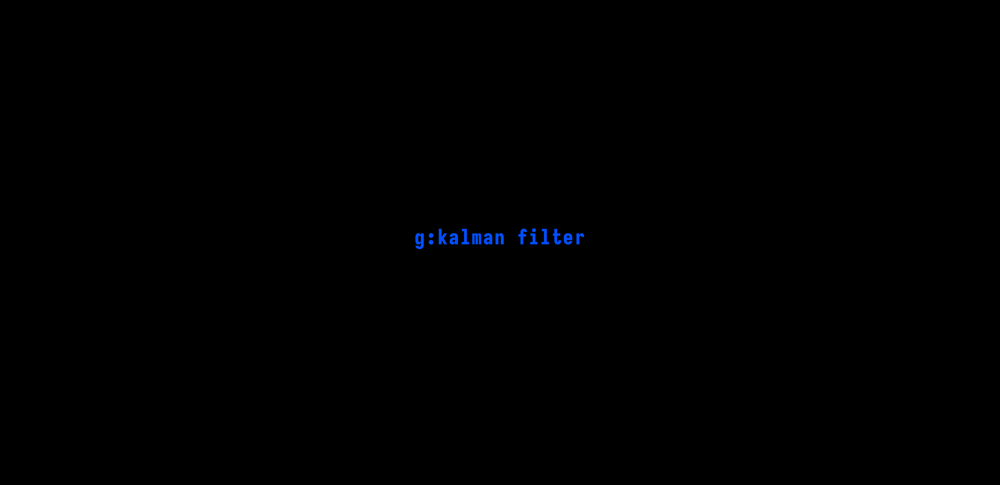
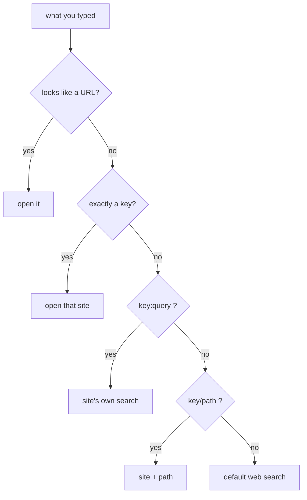

# start-page

**How few keystrokes can a new tab take you anywhere in?**

A browser new-tab page that is a black screen, a clock and a text box. It's
built on Ozenc Bilgili's [Tilde Enhanced](https://github.com/ozencb/tilde-enhanced) (MIT),
re-keyed for how I actually move around the web, in October 2023.



## The idea

Every site I open more than twice a day gets a one- or two-letter key. Type
the key and press Enter. That's it. Across the 21 shortcuts here a key is
**1.38 characters on average**, against **13.3** for the domain it replaces.

The same keys take arguments:

| you type | you get |
|---|---|
| `g` | github.com |
| `g:kalman filter` | GitHub search for "kalman filter" |
| `r/r/robotics` | reddit.com/r/robotics |
| `?` | the grid above |
| anything else | a web search |



## How a line of text becomes a URL

`js/queryParser.js` is the whole brain, and it checks in this order:



Order matters. `d` (Drive) and `dc` (Discord) share a first letter. That only
works because a key must match *exactly*: prefixes never win.

## Use it

```bash
git clone https://github.com/fh1m/start-page && cd start-page
python3 -m http.server 8000      # or point your browser's new-tab setting at index.html
```

Edit `js/config.js` to change keys, colours and categories. Icons live in
`assets/icons/`.

## Notes

- The default search command is labelled `Duckduckgo` but points at Google.
  It's a leftover from the template, and it never shows in the grid.
- Licence: MIT, inherited from Tilde Enhanced (see `LICENSE`).
